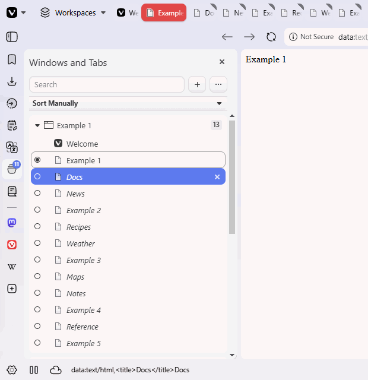
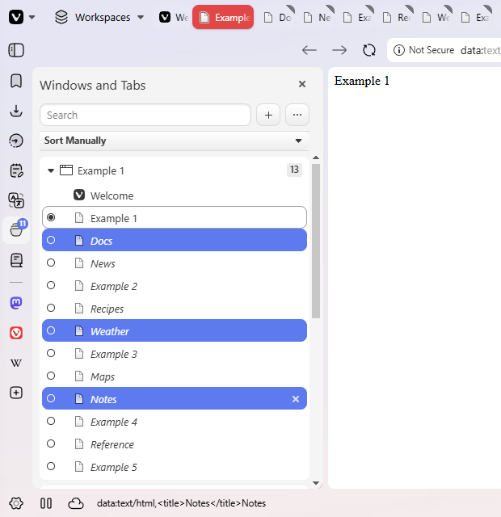
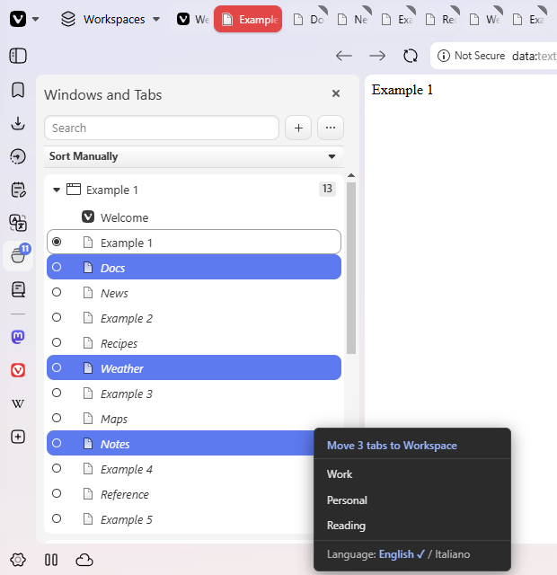

# Vivaldi Workspace Tab Mover — move one or many tabs to a Workspace from the Windows and Tabs panel

Unofficial mod for the **Vivaldi** browser on **Windows**. It adds a **Shift + right-click** menu to the "Windows and Tabs" panel that moves one tab — or many tabs, even non-consecutive ones — to any **Workspace** in one click.
Made for Vivaldi users who keep many tabs spread over many Workspaces and are tired of moving them one by one.
After a Vivaldi update the mod puts itself back automatically (no reinstall, no Windows restart). **English and Italian menu**, switchable from the menu itself.



| Ctrl+click: three non-consecutive tabs | Shift+right-click: the menu moves only those 3 |
|---|---|
|  |  |

| Language row (bottom of the menu) | Same menu in Italian |
|---|---|
|  |  |

*The Workspace names in the screenshots (Work, Personal, Reading) are examples.*

**Version 1.2.0** · [Download (Releases)](https://github.com/milt983/vivaldi-workspace-tab-mover/releases/latest) · [Issues](https://github.com/milt983/vivaldi-workspace-tab-mover/issues) · [Discussions](https://github.com/milt983/vivaldi-workspace-tab-mover/discussions) · License: [MIT](LICENSE)

*[Versione italiana più sotto → ITALIANO](#italiano)*

---

## ENGLISH

### Install in 3 steps

1. Download the zip from [Releases](https://github.com/milt983/vivaldi-workspace-tab-mover/releases/latest) and extract it.
2. Double-click **Install.bat** (or **Install.exe**). Enter the path of your Vivaldi **Application** folder, e.g. `H:\Vivaldi Standalone\Application` (Standalone/Portable) or `C:\Users\<user>\AppData\Local\Vivaldi\Application` (regular install), then choose the language (Enter = detect it from Vivaldi's interface).
3. Open Vivaldi. In the "Windows and Tabs" panel: **Ctrl+click** the tabs you want, then **Shift+right-click** on one of them → choose the Workspace.

### What it does

- **Plain right-click** on a tab in the "Windows and Tabs" panel → Vivaldi's native menu, unchanged.
- **Shift + right-click** on the same tab → the mod's menu ("Move to Workspace").
- **Multi-select, including NON-consecutive tabs**: pick the tabs you want with **Ctrl+click**, then **Shift+right-click** on one of them. The menu reads **"Move N tabs to Workspace"** and moves *only* the tabs you picked, not the ones in between. The selection on screen also stays exactly as you made it: Vivaldi does not extend it to a range. Consecutive selections (Ctrl+click or Shift+click) work as well. Shift+right-clicking a tab that is not part of the selection moves only that tab.
- **Automatic restore after Vivaldi updates**: Vivaldi updates replace its internal files and wipe the mod. A small hidden background watcher starts at Windows login and puts the mod back after an update, **without reinstalling and without restarting Windows**. It normally happens while the update is still running, so the mod is already there the first time you reopen Vivaldi.

Designed for both **Standalone/Portable** and **regular** Vivaldi installations, but regular installs have not been tested recently.

### Language

The menu is available in **English** and **Italiano**.

- **At install time** the installer asks "Language / Lingua: 1) English 2) Italiano" (bilingual screen). Pressing Enter without choosing = the language is **detected automatically from Vivaldi's interface language** (English if it is not Italian). If the mod is already installed, the language you chose last time is proposed.
- **From the menu**: Shift+right-click a tab → the last row of the menu reads **"Language: English ✓ / Italiano"**. Click a language to switch immediately (clicking elsewhere on the row switches to the other one). The row does not move any tab and does not change your selection. Your choice is **remembered** after closing and reopening Vivaldi.
- **After a Vivaldi update** the mod comes back with the language you chose (the watcher restores the files; your choice is stored in the Vivaldi profile and is never touched by the watcher).
- **Precedence**: the choice you make in the browser wins over the one made at install time, which only sets the *initial* language. Reinstalling and picking a *different* language counts as a new explicit choice and applies once.
- The installer and uninstaller screens are bilingual too; their messages follow the language you chose.

### Requirements

- Windows with Windows PowerShell 5.1 (built into Windows). Tested on Windows 11; Windows 10 should work but was not tested. No administrator rights.
- Vivaldi (Standalone/Portable or regular install).

### Package contents

```
Install.bat / Install.exe        → installer (one double-click, identical; the .exe is a thin launcher)
Install-Mod.ps1                  → installation engine (asks the questions, bilingual)
Uninstall.bat / Uninstall.exe    → uninstaller (one double-click, identical)
Uninstall-Mod.ps1                → uninstallation engine
exe-source/                      → C# source of the two thin launchers (+ how to rebuild them)
assets/                          → images used by this README
payload/
├── move-workspace-panel.js      → the actual mod (menu strings: English + Italian)
├── Mod-Common.ps1               → shared functions (safe check/repair)
├── Watcher-Daemon.ps1           → background watcher: puts the mod back after every update
├── Start-Daemon.vbs             → starts it with no windows
├── Watcher-Core.ps1             → on-the-fly check (used by the modified shortcuts)
└── Vivaldi-Launch.vbs           → silent wrapper used by the shortcuts
```

### Automatic maintenance (what runs on your PC)

- A single **hidden** PowerShell process (no window, no tray icon), started at login via an `HKCU\...\Run` entry (no administrator) and right after installation.
- Event-driven, no continuous polling: it waits for a new Vivaldi version folder to appear, waits until `window.html` is complete and stable, then puts the `<script>` tag, the mod file and its small language-config file back (atomic writes, `window.html.bak` backup, never duplicated). Plus a safety check every 30 minutes.
- Measured cost: about **73 MB** of memory, **CPU close to zero** (about 0.005 % at rest).
- Small self-rotating log: `%LocalAppData%\VivaldiWSMod\logs\ws-mod.log`.
- Fully removed by **Uninstall** (stops the process, removes the autostart entry, restores `window.html`, removes the mod and language-config files, deletes `%LocalAppData%\VivaldiWSMod`). Your language choice made in the browser lives in the Vivaldi profile and cannot be removed from outside; without the mod it has no effect.

### Uninstallation

Double-click **Uninstall.bat** or **Uninstall.exe**, enter the same Application path (Enter = the one registered at install time) and confirm. All files, shortcuts and `window.html` are restored to their original state.

### Windows SmartScreen / antivirus

The `.exe` files are **not code-signed**, so Windows SmartScreen or an antivirus may show a warning ("Windows protected your PC"). It is not malware; you can
- use **Install.bat / Uninstall.bat**, which do exactly the same thing and are plain readable text;
- read the code: since v1.2.0 the `.exe` files are tiny (5 KB) thin launchers that only run `Install-Mod.ps1` / `Uninstall-Mod.ps1` (source in `exe-source/`, built with the C# compiler that ships with Windows);
- verify integrity. SHA256 of this version's `.exe` files:
  - `Install.exe`: `207C6C729C5274C141159BC15BBD4082E7AABEADCBA50420DFEDE8BB9C36A0BD`
  - `Uninstall.exe`: `CF9B0063512AFECA03E6AE5FFE09AD20D822704BB6BE2D807747BCD2E6E4D2B3`
  - the SHA256 of the Release **zip** is in the [Release](https://github.com/milt983/vivaldi-workspace-tab-mover/releases/latest) notes (it cannot be in this file, which is inside the zip).

### What has NOT been tested (honesty)

- Tested on Windows 11 with Vivaldi Standalone 8.1.x and 8.2.x. Other Vivaldi versions and "regular" (non-Standalone) installs have not been tried recently: if Vivaldi changes the internal structure of `window.html` or of the panel, the mod may stop working.
- Language detection from Vivaldi's interface was verified with Vivaldi started in English and in Italian (command-line language and the saved app-locale setting) on a test profile; the exact setting your own Vivaldi uses has not been inspected.
- Restore after a **real Vivaldi update** was verified with a simulation (new version folder, file written in several chunks and locked) and against the log of a previous real update, but has not yet been observed live during an actual update.
- Only English and Italian menus exist. The features rely on undocumented Vivaldi internals: use at your own risk.

### Feedback

Does it work for you? Please tell us — in [Discussions](https://github.com/milt983/vivaldi-workspace-tab-mover/discussions) (questions, ideas, "works for me") or [Issues](https://github.com/milt983/vivaldi-workspace-tab-mover/issues) (bugs). Useful info: your **Vivaldi version**, your **Windows version**, Standalone or regular install, whether the mod works (menu appears, tabs move), and, if something fails, the last lines of `%LocalAppData%\VivaldiWSMod\logs\ws-mod.log`.

Full step-by-step guide (IT/EN): [`Guida-Mod-Vivaldi-IT-EN.md`](Guida-Mod-Vivaldi-IT-EN.md).

---

## ITALIANO

Mod non ufficiale per **Vivaldi** su **Windows**: aggiunge al pannello "Windows and Tabs" un menu su **Maiusc + tasto destro** per spostare una tab — o più tab, anche non consecutive — in un **Workspace** con un solo click. Pensato per chi usa molti Workspace e molte tab. Dopo un aggiornamento di Vivaldi la mod si rimette da sola (senza reinstallare né riavviare Windows). **Menu in inglese e in italiano**, cambiabile dal menu stesso. Immagini e GIF sono qui sopra.

### Installazione in 3 passi

1. Scarica lo zip da [Releases](https://github.com/milt983/vivaldi-workspace-tab-mover/releases/latest) e decomprimilo.
2. Doppio click su **Install.bat** (o **Install.exe**). Inserisci il percorso della cartella **Application** di Vivaldi, ad es. `H:\Vivaldi Standalone\Application` (Standalone/Portable) oppure `C:\Users\<utente>\AppData\Local\Vivaldi\Application` (installazione normale), poi scegli la lingua (Invio = rilevata dall'interfaccia di Vivaldi).
3. Apri Vivaldi. Nel pannello "Windows and Tabs": **Ctrl+clic** sulle tab che vuoi, poi **Maiusc + tasto destro** su una di esse → scegli il Workspace.

### Cosa fa

- **Tasto destro semplice** su una tab nel pannello "Windows and Tabs" → menu nativo di Vivaldi, invariato.
- **Maiusc (Shift) + tasto destro** sulla stessa tab → menu del mod ("Sposta nel Workspace").
- **Selezione multipla (anche tab NON consecutive)**: seleziona le tab che vuoi con **Ctrl+clic**, poi premi **Maiusc + tasto destro** su una di esse. Il menu dice **"Sposta N tab nel Workspace"** e sposta *solo* le tab che hai scelto (non quelle in mezzo). Anche la selezione sullo schermo resta quella che hai fatto: Vivaldi non la allarga a intervallo. Funziona anche con selezioni consecutive (Ctrl+clic o Maiusc+clic).
- **Ripristino automatico dopo gli aggiornamenti di Vivaldi**: gli aggiornamenti di Vivaldi sostituiscono i file interni e cancellano la mod. Un piccolo controllo in background, nascosto, parte al login di Windows e rimette la mod da solo dopo un aggiornamento, **senza reinstallare e senza riavviare Windows**. Di norma succede mentre l'aggiornamento è ancora in corso, quindi la mod è già presente alla prima riapertura.

Pensata sia per installazioni **Standalone/Portable** che per installazioni **normali** di Vivaldi, ma le installazioni normali non sono state provate di recente.

### Lingua

Il menu è disponibile in **English** e **Italiano**.

- **All'installazione** l'installer chiede "Language / Lingua: 1) English 2) Italiano" (schermata bilingue). Invio senza scegliere = lingua **rilevata automaticamente dall'interfaccia di Vivaldi** (inglese se non è italiano). Se la mod è già installata, viene proposta la lingua scelta l'ultima volta.
- **Dal menu**: Maiusc + tasto destro su una tab → l'ultima riga del menu dice **"Lingua: English / Italiano ✓"**. Clicca una lingua per cambiarla subito (un clic altrove sulla riga passa all'altra). La riga non sposta nessuna tab e non cambia la selezione. La scelta viene **ricordata** dopo la chiusura e la riapertura di Vivaldi.
- **Dopo un aggiornamento di Vivaldi** la mod torna con la lingua che hai scelto (il watcher ripristina i file; la tua scelta sta nel profilo di Vivaldi e il watcher non la tocca mai).
- **Precedenza**: la scelta fatta nel browser vale più di quella dell'installazione, che imposta solo la lingua *iniziale*. Reinstallare scegliendo una lingua *diversa* conta come nuova scelta esplicita e vale una volta.
- Anche le schermate dell'installer e del disinstallatore sono bilingui; i loro messaggi seguono la lingua scelta.

### Requisiti

- Windows con Windows PowerShell 5.1 (già incluso in Windows). Provato su Windows 11; Windows 10 dovrebbe funzionare ma non è stato provato. Nessun diritto di amministratore.
- Vivaldi (Standalone/Portable oppure installazione normale).

### Manutenzione automatica (cosa gira sul tuo PC)

- Un solo processo PowerShell **nascosto** (nessuna finestra, nessuna icona), avviato al login con una voce `HKCU\...\Run` (nessun amministratore) e subito dopo l'installazione.
- È guidato da eventi, non fa controlli continui: aspetta che compaia una nuova cartella versione di Vivaldi, attende che `window.html` sia completo e stabile, poi rimette il tag `<script>`, il file del mod e il suo piccolo file di configurazione della lingua (scrittura atomica, backup `window.html.bak`, mai duplicati). In più un controllo di sicurezza ogni 30 minuti.
- Consumo misurato: circa **73 MB** di memoria, **CPU vicino a zero** (circa 0,005 % a riposo).
- Log breve, che si ruota da solo: `%LocalAppData%\VivaldiWSMod\logs\ws-mod.log`.
- Si rimuove del tutto con **Uninstall** (ferma il processo, toglie la voce di avvio, ripristina `window.html`, rimuove il mod e il file di lingua, cancella `%LocalAppData%\VivaldiWSMod`). La lingua scelta nel browser sta nel profilo di Vivaldi e non si può cancellare dall'esterno; senza la mod non ha effetto.

### Disinstallazione

Doppio click su **Uninstall.bat** o **Uninstall.exe**, inserisci lo stesso percorso Application (Invio = quello registrato all'installazione) e conferma. Tutti i file, gli shortcut e `window.html` vengono ripristinati allo stato originale.

### Windows SmartScreen / antivirus

Gli `.exe` **non sono firmati digitalmente**, quindi Windows SmartScreen o un antivirus possono mostrare un avviso ("Windows ha protetto il PC"). Non è un malware: puoi
- usare **Install.bat / Uninstall.bat**, che fanno esattamente la stessa cosa e sono testo leggibile;
- leggere il codice: dalla v1.2.0 gli `.exe` sono lanciatori minuscoli (5 KB) che avviano solo `Install-Mod.ps1` / `Uninstall-Mod.ps1` (sorgente in `exe-source/`, compilati con il compilatore C# incluso in Windows);
- verificare l'integrità: gli SHA256 di `Install.exe` e `Uninstall.exe` sono nella sezione inglese qui sopra; lo SHA256 dello **zip** è scritto nelle note della [Release](https://github.com/milt983/vivaldi-workspace-tab-mover/releases/latest) (non può stare in questo file, che è dentro lo zip).

### Cosa NON è stato testato (onestà)

- Testato su Windows 11 con Vivaldi Standalone 8.1.x e 8.2.x. Altre versioni di Vivaldi e le installazioni "normali" (non Standalone) non sono state provate di recente: se Vivaldi cambia la struttura interna di `window.html` o del pannello, la mod potrebbe non funzionare.
- La rilevazione della lingua dall'interfaccia di Vivaldi è stata verificata con Vivaldi avviato in inglese e in italiano (lingua da riga di comando e impostazione salvata) su un profilo di prova; l'impostazione esatta usata dal tuo Vivaldi non è stata ispezionata.
- Il ripristino dopo un **aggiornamento reale** di Vivaldi è stato verificato con una simulazione (cartella versione nuova, file scritto a più riprese e bloccato) e sul log di un aggiornamento reale precedente, ma non ancora osservato dal vivo su un aggiornamento in corso.
- Esistono solo i menu in inglese e in italiano. Le funzioni dipendono da dettagli interni di Vivaldi (non documentati): usa a tuo rischio.

### Feedback

Funziona per te? Dicci come va, in [Discussions](https://github.com/milt983/vivaldi-workspace-tab-mover/discussions) (domande, idee, "per me funziona") oppure in [Issues](https://github.com/milt983/vivaldi-workspace-tab-mover/issues) (problemi). Indica la **versione di Vivaldi**, la **versione di Windows**, se l'installazione è Standalone o normale, se la mod funziona (compare il menu, le tab si spostano) e, se qualcosa non va, le ultime righe di `%LocalAppData%\VivaldiWSMod\logs\ws-mod.log`.

Guida completa passo-passo (IT/EN): [`Guida-Mod-Vivaldi-IT-EN.md`](Guida-Mod-Vivaldi-IT-EN.md).

---

## Disclaimer

*Unofficial project, not affiliated with Vivaldi Technologies. Modifies internal Vivaldi installation files (`window.html`), which get overwritten by browser updates — the mod detects this and reapplies itself automatically.*

Progetto non ufficiale, non affiliato a Vivaldi Technologies. Modifica file interni dell'installazione Vivaldi (`window.html`), che gli aggiornamenti del browser sovrascrivono: la mod se ne accorge e si riapplica da sola.

## License / Licenza

[MIT](LICENSE) © 2026 milt983
